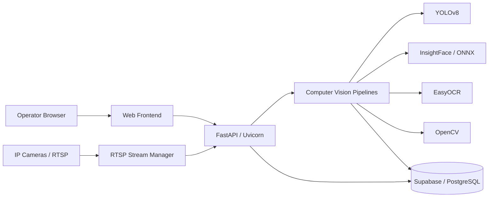

# City Sentinel

**Real-time computer vision and data-engineering framework for smart-city threat detection.**

City Sentinel processes live camera/video streams and applies multiple computer-vision pipelines to detect and record events such as accidents, fire, violence, weapons, and vehicle/license-plate activity. The system exposes inference services through a FastAPI backend and persists structured event data for downstream applications.

> This repository contains the implementation and engineering work behind a university senior design project.

## Highlights

- Real-time video inference using **YOLOv8**, **InsightFace/ONNX**, **EasyOCR**, and OpenCV
- Separate detection services for accident, fire, knife/weapon, violence, and vehicle/license-plate events
- FastAPI application layer served with Uvicorn
- RTSP stream handling with threaded processing
- Structured event persistence through Supabase/PostgreSQL-compatible storage
- Browser-based frontend for interacting with the system
- Dedicated testing scripts for detection services
- Deployment architecture documented in `deployment_diagram.drawio`

## Architecture



## Detection Pipelines

| Pipeline | Purpose | Core Technologies |
| --- | --- | --- |
| Accident detection | Identify road-incident events from video | YOLOv8, OpenCV |
| Fire detection | Detect fire-related visual events | YOLOv8, OpenCV |
| Weapon detection | Detect knife/weapon-related events | YOLOv8, OpenCV |
| Violence detection | Identify violence-related visual events | Computer vision, OpenCV |
| Vehicle / ANPR | Detect vehicles and extract plate information | YOLOv8, EasyOCR, OpenCV |
| Face analysis | Face detection/recognition components | InsightFace, ONNX |

## Project Structure

```text
.
├── app/                       # FastAPI services and application logic
├── frontend/                  # Browser-facing frontend
├── accident_detection/        # Accident detection pipeline
├── fire_detection/            # Fire detection pipeline
├── knife_detection/           # Knife/weapon detection pipeline
├── Report/                    # Project documentation
├── deployment_diagram.drawio  # Deployment architecture
├── setup_*_table.sql          # Database schema/setup scripts
└── requirements.txt            # Python dependencies
```

## Technology Stack

**Backend:** Python, FastAPI, Uvicorn  
**Computer Vision:** YOLOv8, OpenCV, InsightFace, ONNX Runtime, EasyOCR  
**Data:** Supabase / PostgreSQL-compatible database, SQL  
**Frontend:** Next.js / browser-based interface  
**Streaming:** RTSP video streams, threaded processing  
**Hardware:** NVIDIA GPU/CUDA recommended, with CPU fallback

## Local Setup

### 1. Clone the repository

```bash
git clone https://github.com/bakardon/city-sentinel.git
cd city-sentinel
```

### 2. Install dependencies

```bash
python -m venv .venv

# Linux/macOS
source .venv/bin/activate

# Windows
.venv\Scripts\activate

pip install -r requirements.txt
```

### 3. Configure services

```bash
cp .env.example .env
```

Fill in the variables you need. [`.env.example`](.env.example) lists them grouped by module: Supabase credentials, model weight paths, RTSP camera URLs and per-detector thresholds. Everything is optional; without Supabase the services fall back to in-memory storage. Model weights and camera streams are deployment-specific and are not assumed to be bundled with the repository.

### 4. Start the API

```bash
uvicorn app.main:app --host 0.0.0.0 --port 8010
```

The exact frontend and inference configuration depends on the available camera streams, model weights, and database credentials.

## Deployment

The repository includes a detailed Draw.io deployment diagram covering the operator workstation, web frontend, on-premises application server, RTSP stream handling, ML runtimes, GPU/CPU execution, and database components.

Open `deployment_diagram.drawio` with [diagrams.net](https://app.diagrams.net/) to inspect or edit the architecture.

## Engineering Focus

The main engineering challenge is integrating multiple computer-vision workloads into a single real-time application while keeping stream handling, inference, persistence, and operator-facing functionality separated into manageable components. The repository therefore emphasizes service boundaries, real-time processing, hardware-aware inference, and structured event storage rather than a single standalone ML model.

## Disclaimer

City Sentinel is a research/academic engineering project and is **not presented as a production-ready public-safety system**. Detection performance depends on the trained models, camera placement, lighting, hardware, and deployment configuration.
